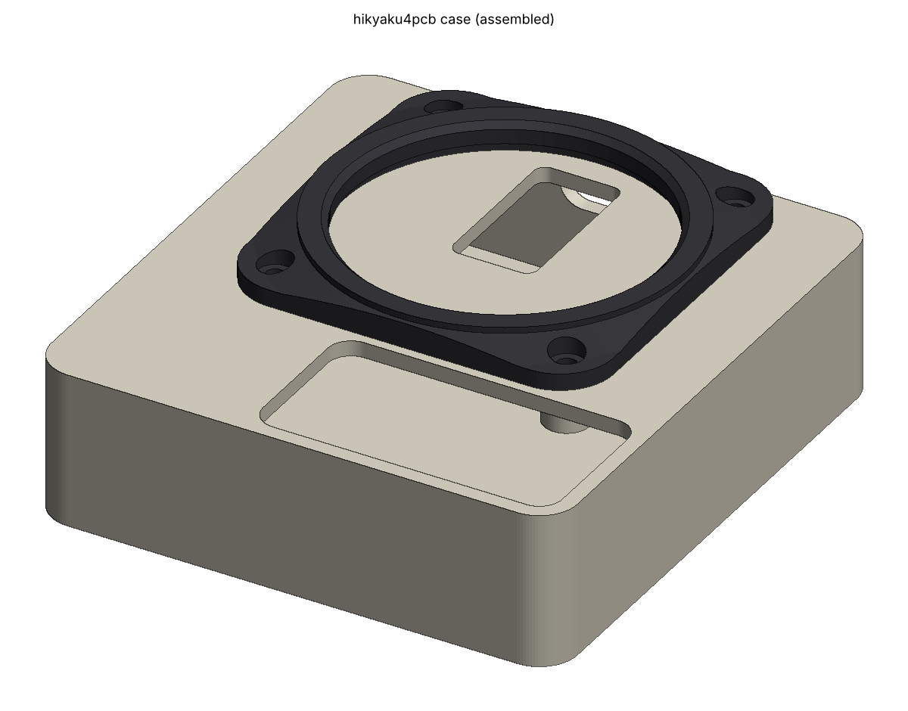
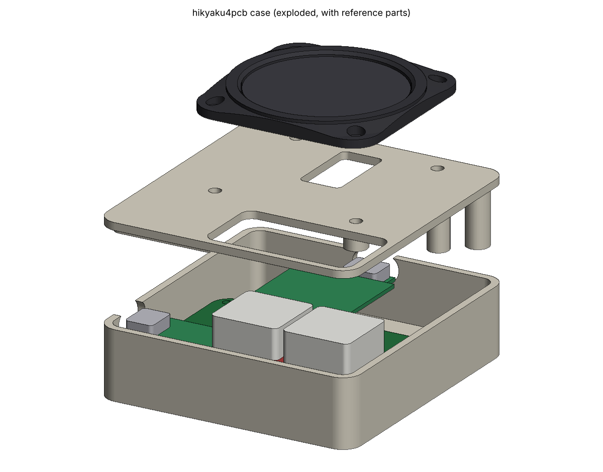

# hikyaku4pcb のケース（叩き台）

PCB 版（`pcb/`）のケース。Fusion のスクリプトで、ガーバーの外形・穴から作ったスケッチと、底・ふた・トラックパッドのリングを組み立てる。
**数値の多くは推定**なので、実物を測ってからパラメータを直して作り直す前提（下の「測って直す値」）。

| ファイル | 中身 |
|---|---|
| `hikyaku4pcb_case/hikyaku4pcb_case.py` | Fusion のスクリプト。寸法はすべて冒頭の「パラメータ」 |
| `preview.py` | 同じ手順を manifold3d で実行し、`stl/` と `preview_*.png` を作る（Fusion なしで形と干渉を確かめる用） |
| `run_in_fusion.py` | 起動中の Fusion に MCP 経由で同じ手順を実行させる（ターミナルから作り直す用） |
| `stl/` | 部品ごとの STL（Z 上向き、mm）。いまのパラメータの形 |




## Fusion で作る

1. Fusion で `hikyaku4pcb` を開く。
2. ユーティリティ → **スクリプトとアドイン** → 「+」→ **マイコンピュータからスクリプトを追加** で、`hikyaku4pcb_case` フォルダを選ぶ。
3. 一覧の `hikyaku4pcb_case` を実行する。

できるコンポーネント（実行し直すと、同じ名前のものを消して作り直す）:

| コンポーネント | 中身 |
|---|---|
| `PCB_ref` | スケッチ「PCB外形」（Edge_Cuts そのまま。63.586 × 52、奥の角 R5・手前の角 R2）と「PCB穴」（NPTH・PTH・MX の長穴すべて）、厚さ 1.6 の板 |
| `Ref_parts` | S3・CH9102F・FFC 変換基板・MX スイッチ・キーキャップ・トラックパッドの仮の箱（`gen_models.py` と同じ推定寸法） |
| `Bottom` | 底のトレイ。基板を受けるボス、4 つ目の穴（SW2 のキーキャップの下）は位置決めピン、左に S3 の USB-C、奥に CH9102F の USB-C |
| `Cover` | ふた。キーの窓、FFC の穴、裏に位置合わせの縁・基板を押さえる柱・ねじのボス |
| `TrackpadRing` | トラックパッドを上から包む円形のトッププレート。四角い土台の上に円いリングが立ち、斜面は土台の辺で切れて平らな面になる。四隅に座ぐり |

- 座標は、原点 = 基板の左下（KiCad の (54, 148)）、Z = 0 が基板の下面。Fusion が **Y 上向き**の設定なら、自動で回して作る（`UP` で固定もできる）。
- 開いているファイル名に `hikyaku4pcb` が入っていなければ、作る前に確認が出る。
- フィレット（ふたの上の縁 R1、底の縁 R1、リングの上の縁 R0.5）は Fusion でだけ付ける。付けられなかったときは最後のメッセージに出る。

2026-11-05 に Fusion（Y 上向きの設定）で実行して、エラー・警告・壊れたフィーチャなしで作れた。フィレットも全部付いた。
体積は manifold3d の版（`stl/`）とほぼ同じで、差はフィレットで削れる分だけ（Bottom −58、Cover −57、TrackpadRing −10 mm3）。
Fusion の干渉チェックでも、ケースと仮の箱は重ならない（重なるのは仮の箱どうしの MX の上部とキーキャップだけ）。

### ターミナルから作る（Fusion の MCP サーバー）

Fusion の基本設定の「一般」→「Fusion MCP サーバ」を有効にしておくと、Fusion が `http://127.0.0.1:27182/mcp` で待ち受ける。
hikyaku4pcb を開いた状態で、

```bash
python3 run_in_fusion.py                 # 作り直す（警告と各ボディの体積を出す）
python3 run_in_fusion.py --shot out.png  # 作り直して、スクリーンショットも保存
```

スクリプトとアドインから実行するのと同じものができる。保存はしないので、残すときは Fusion で保存する。
Claude Code から Fusion を直接操作するなら `claude mcp add --transport http fusion http://127.0.0.1:27182/mcp` で登録する。

## 形の決め方

### トラックパッドの挟み方（旧ケースから）

`3dData/Top_new.stl` を輪切りにして測った値をそのまま使った:

| | 旧 Top_new | 新 TrackpadRing |
|---|---|---|
| 下の出っ張りが入る穴 | Ø42、深さ 1.5 | Ø42、深さ 1.5（`TP_FLANGE_D` / `TP_FLANGE_T`） |
| 上に出る部分の窓 | Ø40、厚さ 1.5 | Ø40（`TP_BODY_D`） |
| 出っ張りを受ける面 | ボトムプレート（1.5） | ふたの上面 |
| FFC の穴 | ボトムの 10 × 20（パッド中心から 7 ずれ） | ふたに 11 × 21（`FFC_HOLE`） |

パッドの表面はリングの上面から 1.2 下がる（`RING_PROUD`）。窓の縁は 0.8 の面取りで、指が縁まで滑るようにした。

### 配置

- **キー（SW1・SW2）が基板の手前**にあるので、トラックパッドは奥（`TP_CX`, `TP_CY` = (31.8, 45.5)）。リングの手前の端はキーの窓から 1.3 離れる。
- **CH9102F は基板の奥に約 16mm はみ出す**（`gen_models.py` の向き: 25mm の基板がピンから -Y（KiCad）へ伸びる）。その USB-C を奥の壁に出すため、箱の内側を Y = 68.5 まで伸ばした。外形は 68.6 × 73。
- 高さ: 床の下面 -5.5 → 基板 0〜1.6 → ふた 12.6〜14.6 → リングの上面 18.8（いずれも mm）。

### ねじ（M2）

| 場所 | 数 | ねじ | 受け |
|---|---|---|---|
| 床の裏 → 底のボス → 基板の穴 → ふたの柱（基板を挟む） | 3 | M2 × 8 | ふたの柱にヒートセットインサート |
| 床の裏 → ふたの柱（奥の 2 本） | 2 | M2 × 4〜5 | 同上 |
| リングの四隅 → ふた | 4 | M2 × 4〜5（低頭がよい） | ふたの裏のボスにインサート |

ヒートセットインサート M2（下穴 Ø3.2・深さ 4、`INSERT_D` / `INSERT_DEPTH`）が 9 個。タップを立てるなら `INSERT_D` を 1.7 前後にする。
上面にねじが見えるのはリングの四隅だけ。

### 印刷の向き

- `Bottom`: 床を下に。
- `Cover`: 上面を下に（柱とボスが上に伸びる）。
- `TrackpadRing`: 下面を下に。黒など導電性のないフィラメントにする（パッドの仕様: ベゼルに導電性の素材を使わない）。

## 測って直す値

推定のままなので、実物で測ってから直す。preview.py は仮の箱とケースの重なりを出すので、直したら流して確かめる。

| パラメータ | いまの値 | 測るもの |
|---|---|---|
| `MODULE_LIFT` | 2.5 | ソケットの上面からモジュール（S3・CH9102F・FFC 変換基板）の基板の下面まで。ピンヘッダの樹脂の厚さ。USB-C の穴の高さが決まる |
| `INNER_H` | 11.0 | 基板の上面から、いちばん高い部品（S3 の USB-C、FFC 変換基板のコネクタ、折り返した FFC）まで + 余裕 |
| `CAV_TOP_Y` | 68.5 | CH9102F の USB-C の口の位置（基板の奥の端から何 mm 出るか + 52） |
| `S3_USB_Y` / `CH_USB_X` | 10.62 / 31.79 | 各 USB-C の中心（モジュールの中心からずれていないか） |
| `TP_FLANGE_D` / `TP_BODY_D` / `TP_FLANGE_T` / `TP_ABOVE` | 42 / 40 / 1.5 / 1.5 | トラックパッドの下の出っ張りの径と厚さ、上の部分の径と高さ |
| `FFC_HOLE` | 11 × 21、+7 | パッドの裏のコネクタと部品の位置。パッドの向き（外周の切り欠き 3 つ）と合わせる |

**気になっている点:**

- `gen_models.py` の推定のままだと、**FFC 変換基板（26 × 24）と CH9102F（25 × 11）の板が重なる**（どちらも J3・J4 のソケットから奥へ伸びるため）。実物でどちらが上に重なるのかを見て、高さを決める必要がある。
- トラックパッドの裏の部品（部品込みの厚さ 5.4）が FFC の穴から下に約 4 出る。その真下に FFC 変換基板のコネクタが来るので、`INNER_H` はそれも入れて決める。
- S3 の RGB LED（起動時の赤 → 緑）を見る窓はまだない。位置が分かれば `Cover` に穴を足す。

## プレビューを作り直す

```bash
python3 -m venv .venv && .venv/bin/pip install manifold3d numpy matplotlib
.venv/bin/python preview.py
```

`干渉: A と B が … mm3 重なっている` が出なければ、仮の箱とケースはぶつかっていない。
